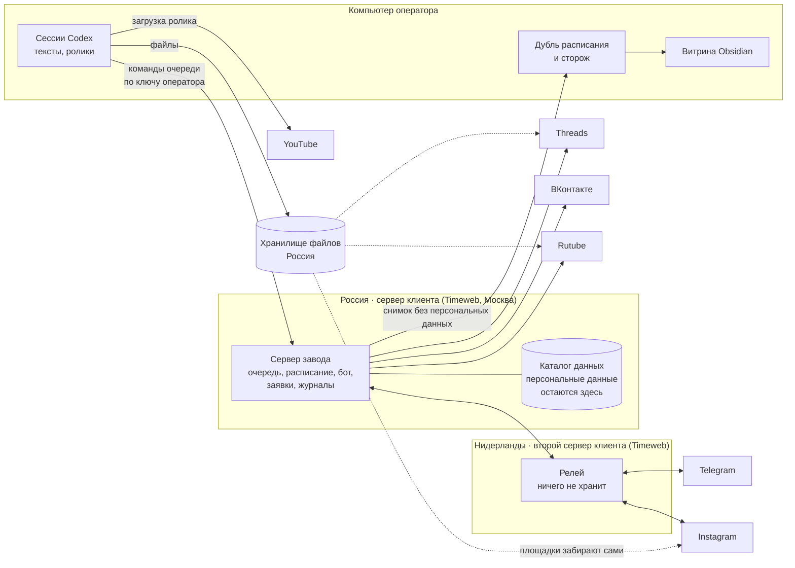
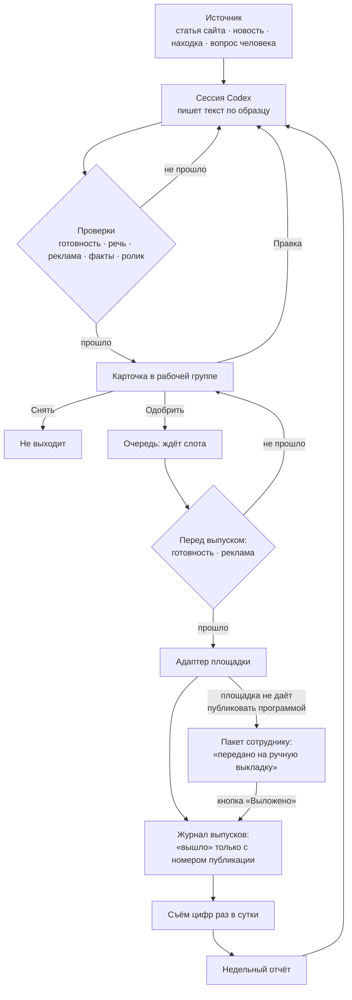
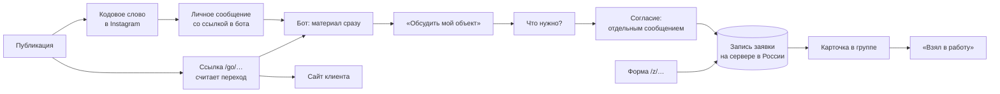

# Архитектура завода

Что где стоит, как идёт материал и почему решено так. Решения этого документа в сессиях Codex не пересматриваются: менять их может только владелец проекта.

## 1. Три машины

| Машина | Что делает | Чья |
|---|---|---|
| Сервер в России | хозяин очереди и расписания; бот; приём заявок; журналы; персональные данные | клиента |
| Релей за границей | передаёт вызовы к Telegram и Instagram и их события обратно; ничего не хранит | клиента |
| Компьютер оператора | сессии Codex, монтаж и загрузка роликов, дубль расписания, сторож, витрина | исполнителя |

## 2. В какой стране сервер

**Основной сервер: Россия, Москва.** Причина одна и она не обсуждается: закон требует, чтобы первичная запись и хранение персональных данных россиян шли на серверах в России (часть 5 статьи 18 закона № 152-ФЗ). Завод принимает заявки с именами и телефонами, значит, его база стоит в России. Сервер за границей сделал бы незаконной каждую принятую заявку.

Москва, а не Санкт-Петербург или Новосибирск: клиент в Казани, основная аудитория в европейской части, разница в задержке между российскими площадками для завода значения не имеет. Берём самую ходовую.

**Но с сервера в России не достать до Telegram и Instagram.** `api.telegram.org` и `graph.instagram.com` оттуда не отвечают. `graph.threads.net`, ВКонтакте и Rutube отвечают напрямую.

**Поэтому второй сервер: Нидерланды, самый маленький тариф.** На нём стоит релей: программа на сто строк, которая передаёт запросы туда и обратно и ничего не сохраняет.

Почему Нидерланды, а не Cloudflare, на котором релей живёт в двух наших проектах:

| | Второй сервер Timeweb в Нидерландах | Cloudflare Workers |
|---|---|---|
| Договор и счёт | тот же поставщик, тот же кабинет, тот же счёт | отдельная учётная запись у компании из США |
| Персональные данные | страна — сторона Конвенции о защите данных: передачу можно начинать после уведомления Роскомнадзора | США в перечень стран с адекватной защитой не входят: после уведомления нужно ждать решения |
| Устойчивость | обычная связь между двумя площадками одного поставщика | доступ к Cloudflare из России периодически замедляют |
| Наш опыт | код тот же, среда новая | работает в двух проектах |
| Цена | несколько сотен рублей в месяц | бесплатно |
| Время запуска | около часа: сервер, домен, сертификат | десять минут |

Вывод: по умолчанию Нидерланды. Cloudflare остаётся запасным: код релея один и тот же (`ops/relay/relay.mjs`), меняется только обвязка.

Германия (Франкфурт) подходит так же, как Нидерланды. Казахстан (Алматы) не берём: опыта работы с Meta и Telegram оттуда у нас нет, а выигрыша перед Нидерландами тоже нет.

## 3. Путь материала

Одна запись очереди — один материал на одной площадке в один слот. Статья, разошедшаяся в Threads, Telegram и ВКонтакте, даёт три записи с общим полем `material`.

## 4. Путь заявки

Порядок важен: сначала запись на сервере, потом уведомление. Заявка не зависит от того, доступен ли в эту секунду Telegram.

## 5. Что где лежит

| Что | Где | Уезжает ли на компьютер оператора |
|---|---|---|
| Очередь (`queue.jsonl`), журнал выпусков (`ledger.jsonl`) | сервер, каталог данных | да, копией раз в 15 минут |
| Цифры, новости, находки, отчёты | сервер, каталог данных | да |
| Заявки, подписчики бота | сервер, `data/leads/` | **нет**; только счёт |
| То, что люди пишут в бот | сервер, `data/leads/` | **нет**; только число вопросов. Открыть текст может клиент письменным решением: `zavod.config.json`, блок `privacy` |
| Публичные комментарии под публикациями | сервер, каталог данных | да: без имени и аккаунта автора, телефоны и почта вычищены. Клиент может закрыть |
| Журнал согласий | сервер, `data/leads/consents.jsonl` | нет |
| Ключи площадок | сервер, `/opt/ecopolis-data/.env` | копия у оператора на случай аварии |
| Токен бота Telegram | секреты релея | нет |
| Ключи хранилища файлов | компьютер оператора | — |
| Тексты, сценарии, промпты, код | проект (git) | это и есть компьютер оператора |
| Ролики-исходники | диск оператора | — |

## 6. Правила, на которых держится завод

1. **Без «Одобрить» от человека клиента не выходит ничего.** Кнопку нажимает утверждающий в рабочей группе. Имя и время записываются.
2. **У очереди один писатель** (`src/queue/store.mjs`). Сессии, бот и выпуск зовут его; сами в файл не пишут.
3. **Журнал только дописывается.** По номеру записи побеждает последняя строка; история остаётся.
4. **«Выходит» пишется до отправки на площадку.** Второй проход эту запись не возьмёт.
5. **«Вышло» пишется только с номером публикации от площадки.** «Принято» не значит «вышло». Пакет, отправленный человеку на ручную выкладку, тоже не «вышло»: у него свой статус, «передано», и публикацией его делает кнопка «Выложено».
6. **Опоздавшее больше чем на шесть часов не выходит.** Человеку уходит кнопка.
7. **Выпускает всегда кто-то один.** Сервер либо компьютер оператора, никогда оба. Перехват начинается, только когда сервер принял остановку либо оператор остановил его сам и подтвердил это. В рубильнике независимые отметки: слово человека, перехват и возврат. Отметку перехвата снимает только возврат; слово человека перехват не затирает, а возврат не снимает. При перехвате компьютер перед каждым проходом сверяется с сервером. Сервер, поднятый из архива, не выпускает до сверки с копией расписания: архив старше копии.
8. **Персональные данные не покидают сервер.** Снимок для оператора содержит только счёт. На компьютере оператора тексты читают программы на основе искусственного интеллекта, работающие за границей, поэтому то, что человек написал в бот, туда не попадает вовсе.
9. **Значение ключа не печатается нигде.** В вывод идёт имя и отпечаток.
10. **Код 1 — отказ по правилу, код 2 — поломка.** Их нельзя смешивать.
11. **Тревога несёт действие, выполнимое с телефона.** И не повторяется чаще раза в шесть часов.
12. **Посредников нет.** С площадками работает свой код: сервисы автопостинга и конструкторы ботов не подключаются. Это решение владельца.
13. **Приём персональных данных открывает клиент.** Бот для людей, формы и кодовые слова закрыты в коде, пока юрист клиента не утвердил тексты согласий, а компания не подтвердила уведомления в Роскомнадзор: `src/leads/legal.mjs`. Переключателя «включить на минуту» нет. Пока приём закрыт, проверка готовности не выпускает публикацию с кодовым словом, ссылкой в бота или на форму: человек пришёл бы к отказу.
14. **Срок выхода ролика на YouTube следует за записью.** Ролик загружается закрытым с датой, и открывает его сам YouTube: это вторые часы выпуска, которых очередь не видит. Поэтому «Снять», «Отозвать согласие», правка и остановка выпуска человеком снимают срок с ролика, а перестановка слота его двигает: `src/video/schedule.mjs`. О неудаче человек узнаёт сразу и с действием.
15. **Рабочая сетка записана в программе.** Сколько и по каким дням выходит на площадке, задаёт поле `grid` в `zavod.config.json`, и запись без времени встаёт по нему сама. Ролик на других площадках встаёт после премьеры на YouTube.

## 7. Состав кода

| Каталог | Что в нём |
|---|---|
| `src/queue/` | формат записи, хранилище, команды, выпуск, слоты и рабочая сетка, рубильники, журнал, снимок, дубль |
| `src/gates/` | пять проверок и список штампов. Готовность и реклама останавливают и перед самым выпуском |
| `src/channels/` | по файлу на площадку: Threads, Telegram, ВКонтакте, Дзен, Instagram, YouTube, Rutube, рассылка в боте |
| `src/bot/` | согласование, пульт группы, бот для людей, заявки, кодовые слова Instagram |
| `src/leads/` | счётчик ссылок и метки площадок, форма заявки, сторож срока ответа, удаление данных, заслон приёма до утверждения согласий |
| `src/news/` | сборщик новостей, статьи сайта клиента |
| `src/trends/` | слежение за чужими каналами |
| `src/comments/` | сбор комментариев под публикациями, без имён авторов |
| `src/metrics/` | съём цифр, сводка, недельный отчёт |
| `src/tokens/` | реестр переменных, сроки и продление ключей, вход в Meta, перенос ключей между машинами |
| `src/media/` | загрузка файлов в хранилище |
| `src/video/` | YouTube: описание по схеме, серии и плейлисты, опись канала, срок выхода ролика вслед за записью очереди |
| `src/vault/` | сборщик витрины Obsidian |
| `src/server.mjs`, `src/doctor.mjs` | сервер и проверка готовности |
| `packages/bot/` | движок бота из наших прошлых проектов (143 теста) |
| `ops/` | cron, systemd, nginx, выкладка, релей, задачи Windows |
| `bot/` | сценарии кодовых слов, материалы, тексты бота, ссылки, формы |
| `reference/` | образцы кода из прошлых проектов; в git и на сервер не попадают |

Зависимостей нет: только Node 20 и новее. Сборки нет: файлы исполняются как есть.

## 8. Чего в заводе нет и почему

- **Сервисов автопостинга и конструкторов ботов.** Решение владельца. Причина из опыта: посредник две недели принимал ролики и не выпускал их, а журнал писал «вышло».
- **Базы данных.** Объём — сотни записей в месяц. Файлы-журналы читаются глазами, копируются одной командой и не требуют администрирования.
- **Автоматических ответов на вопросы людей.** Бот передаёт вопрос человеку и возвращает его ответ.
- **Кнопки «опубликовать сейчас».** Обход расписания ради одного поста дороже, чем подождать пять минут до ближайшего прохода.
- **Автоматического перехвата расписания компьютером.** При первом же сетевом сбое он дал бы двух выпускающих.
