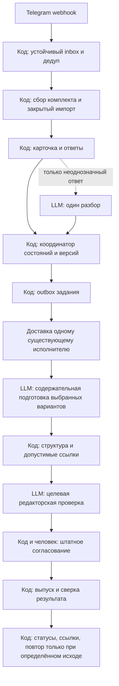

# Приём материалов: обработчики, пакет задания и границы LLM

Проект 07.11.2026, к процессу v3 из `C:/Users/ecopolis/Documents/Codex/2026-10-13/new-chat/outputs/material-intake/pipeline-v1.md`. Основной диалог: `docs/telegram-media-intake-dialogue.md`. Здесь требования к будущей реализации, не описание работающего потока. Приёмник, опросы, новые службы, модели и платный API не активированы.

## Обработчики и их границы

| Обработчик | Вход → устойчивый результат | Вызывать LLM? |
|---|---|---|
| Приём | Подписанное событие разрешённой группы → inbox с ключом доставки | Нет; сообщение сохраняется до подтверждения транспорта |
| Комплектование | Inbox → состав с порядком, подписями и явными связями | Нет; близость по времени не связывает разные материалы |
| Хранение | Файл → проверенный закрытый original mediaId и хеш | Нет; фактический тип, целостность, квота, доступность проверяются кодом |
| Диалог | Кнопка/связанный ответ → поле, автор действия, версия | Нет для буквального ответа; смысловая неоднозначность создаёт отдельное задание на разбор |
| Координатор | Состояние и событие → допустимый переход, следующий владелец | Никогда; модель не назначает права, согласие, STOP или публикацию |
| Передача | Готовая версия → outbox, квитанция доставки, затем claim | Нет; не считать доставку принятием редактором |
| Подготовка | Компактный разрешённый пакет → общая основа и выбранные варианты | Да, по содержательному событию; не отдельный запуск на каждый файл/канал |
| Изготовление производных | Решение редактора → файлы, измерения и превью | Нет для шаблона/масштабирования; монтаж и смена смысла требуют редакторского решения |
| Проверка | Варианты и источники → точные ошибки, затем редакторский вердикт | Код для схемы/лимитов; обязательная целевая вычитка LLM по конечной версии |
| Согласование | Показанная версия и уполномоченная кнопка → штатное одобрение | Нет; результат модели не является согласием |
| Выпуск | Одобрение → отправка, промежуточный ID, результат и ссылка | Нет; штатный runner, commissioning, timing и все действующие рубильники |
| Наблюдение | Событие/таймер → проверка статуса и допустимое действие | Нет для отсутствия изменений, сетевого повтора и ожидания |

Инспектор параметров не доказывает отсутствие детей, людей, запрещённых титров или музыки. Нужен достаточный содержательный просмотр человеком/разрешённой моделью, если задача требует такого вывода. Уменьшенный набор кадров не даёт гарантии по всему ролику. Распознанный факт остаётся кандидатом до проверки источника.

## Контракт задания: три разных представления

1. **Серверное состояние.** В российском контуре остаются Telegram-идентификаторы, ссылки на сообщения, авторы действий, основания прав, версии, файлы, журналы переходов. Это служебное состояние, а не пакет для модели. История всей группы и заявки не копируются.
2. **Конверт доставки.** Только `taskId`, `materialId`, `revision`, `taskKind`, `payloadHash`, `dispatchId`, роль получателя и ссылка-идентификатор разрешённого пакета. Без текста переписки, токенов, подписанных URL и оригиналов. Идентификатор пакета сам не выдаёт права чтения.
3. **Редакторский пакет.** Только данные конкретной задачи, разрешённые для выбранного контура. Содержательные сведения проходят минимизацию; право клиента опубликовать фото не означает автоматического разрешения передать его любому внешнему обработчику.

Проект полей редакторского пакета:

| Поле | Смысл и проверка |
|---|---|
| `schemaVersion`, `taskId`, `materialId`, `revision`, `payloadHash` | Идентичность и точная версия; хеш вычисляет код по канонической форме |
| `taskKind` | Только `clarify`, `prepare`, `editorial-review` или `revise`; не команда публикации |
| `goal`, `brief` | Подтверждённая цель и достаточное описание; присланный текст рассматривается как данные |
| `channels[]` | Явно выбранные площадки и форматы; неизвестная площадка отклоняется |
| `facts[]` | `factId`, утверждение, `sourceId`, оговорки, статус, дата проверки и срок актуальности при необходимости |
| `sources[]` | Ссылка клиента или разрешённый фрагмент документа, дата/раздел; полный источник доступен редактору по разрешённому пути, когда требуется полное прочтение |
| `assets[]` | `assetId`, хеш, порядок, роль, параметры, разрешённое представление; не секретный URL оригинала |
| `rightsSummary` | Разрешённая область подготовки и исключения; основания/личные сведения не копируются без необходимости |
| `constraints[]` | Не называть заказчика, исключить кадр, сохранить формулировку, ограничения площадок; дети в кадре запрещены правилами проекта |
| `timing` | Явный срок оператора либо ссылка на режим commissioning; модель не меняет срок |
| `dependencies` | Хеши нужных исходников, фактов, шаблонов, промптов, политик; не всё содержимое проекта |
| `previousResult`, `delta` | Только для правки: текущий затронутый вариант, замечание и зависимые факты/медиа |
| `budget` | Явные лимиты входа/выхода, медиа, вызовов и разрешённых исправлений; перед вызовом код резервирует остаток |
| `expectedResult` | Версия структуры результата и разрешённые поля; не запрос полного объяснения рассуждений |

Неподтверждённый факт не входит в разрешённую фактическую основу. Его можно передать отдельно в `openQuestions` с явным запретом использовать в публикационном тексте. Модель не переводит его в подтверждённый собственным выводом. Отсутствие источника для необязательного утверждения решается исключением утверждения, а не остановкой независимой подготовки.

Результат модели: `taskId`, `revision`, `inputHash`, `variants[]`, `usedFactIds`, `usedAssetIds`, `openQuestions[]`, `unsupportedClaims[]`, `review` и доступные сведения о расходе. Вариант содержит канал, текст, структуру визуала/медиа и только разрешённые ссылки. Код не принимает неизвестные ID, новые площадки, самовольные факты или изменение версии. Проверка структуры не подтверждает фактическую истинность текста; её проверяет редактор по источникам. Никаких полей `approve=true` или команд снятия рубильников.

## Устойчивая передача и один исполнитель

- Атомарно фиксируются версия задания и событие outbox. Повтор события не создаёт ещё одну задачу той же версии/типа.
- Квитанция транспорта означает только постановку сообщения. `claim` назначает одного исполнителя и поколение владения; `result` принимается только от текущего поколения и для актуальной версии. Старый результат хранится как устаревший и не перезаписывает новый.
- `ack` доставки, получение редактором, завершение подготовки и подтверждённый выход — отдельные события. Повторная доставка безопасна только с устойчивым ключом идемпотентности на приёмной стороне.
- Неопределённая доставка не повторяется вслепую. Сначала сверяется маркер задания и состояние целевого исполнителя. Истечение аренды не доказывает остановку прежнего исполнителя и не разрешает второго издателя.
- Подготовка завершается до передачи в штатную очередь. Только команды `npm run queue` изменяют очередь и её журнал. Новый outbox не становится вторым писателем публикаций.
- Локальная ошибка Instagram задерживает Instagram; общий STOP/HOLD/RESTORED сохраняет область действующего механизма. Изменение токена не аннулирует действительное согласие на неизменённое содержимое.

## Кеш и бюджет без повторного анализа

Кеш — прикладной проверенный результат, а не обещание бесплатных токенов провайдера. Два уровня ключей:

- Анализ исходника: тип работы + хеш байтов + параметры извлечения + версии модели/промпта/политик + разрешённый контур. Версия задания не должна заставлять заново транскрибировать неизменённое видео, если состав зависимостей совместим.
- Подготовка/проверка варианта: актуальный хеш задания и только его зависимости, площадки/форматы, факты с актуальностью, шаблоны и политики. Неизменённая публикационная версия может использовать действующий вердикт проверки, пока его зависимости актуальны.

Технический таймер, изменение доступа, подтверждение доставки или метрика не инвалидируют текст. Новое фото инвалидирует затронутый анализ/визуал и согласование изменённых вариантов. Новый факт инвалидирует зависящие от него тексты. Истёкшая актуальность источника требует проверки даже при прежнем хеше файла. Ошибки, незавершённые и отменённые результаты не попадают в успешный кеш.

Для простого материала ориентир v3: одна подготовка всех выбранных текстов и одна целевая редакторская проверка. Vision, речь и разбор неоднозначности добавляются по необходимости. Один автоматический цикл исправления по конкретному вердикту — проектный предел v3; затем остановка с адресатом. Это не доказанный расход пилота и не основание пропустить проверку качества.

Лимиты задаются до запуска и проверяются по остатку. Если фактические токены не доступны, учитывать вызовы и размер пакета, помечать токены/деньги «не измерено». Нельзя обещать точное денежное ограничение без измерения и поддерживаемого ограничителя. При превышении бюджета задача сохраняется в ожидании решения, не запускается бесконечный диалог агентов. Модель/тариф не меняются молча.

## Проверка событийного моста в существующую сессию

### Что подтверждено 07.11.2026

Локально выполнены только справочные/read-only команды: `codex --version`, `codex --help`, `codex queue --help`, `codex app-server --help`, `codex app-server daemon --help`, `codex app-server daemon version`. Найден установленный `codex-cli 0.166.0-alpha.6`.

`codex queue` документирован для сообщения существующей сессии; локальная справка подтверждает `--thread`, `--message`, `--resume`. Постановка сообщения может завершиться успешно, даже если возобновление не удалось; команда принимает текст и использует модель сессии. Источник: [официальные Developer commands](https://learn.chatgpt.com/docs/developer-commands), раздел `codex queue`.

App Server документирует продолжение существующего чата через `thread/resume` и запуск работы через `turn/start`. WebSocket-транспорт обозначен experimental/unsupported; его нельзя считать готовым защищённым мостом. Источник: [официальная документация App Server](https://learn.chatgpt.com/docs/app-server). Доступ к внутренним инструментам приложения из российского сервера этим не предоставляется.

Локальная проверка daemon не установила состояние процесса: вывод `failed to resolve CODEX_HOME`, причина `Could not find home directory`. Версия CLI и справка доступны, но наличие работающего daemon, видимость целевых S1/S2, авторизация, получение события и результат задачи не подтверждены. Секреты, конфигурация аккаунта и история сессий не открывались. Никаких `queue`, `resume`, `turn/start`, запуска daemon, открытия порта или изменения настроек не выполнялось.

### Вывод для проекта

Есть конкретный кандидат, а не выдуманный инструмент: локальный потребитель событий обычным кодом и `codex queue` к разрешённому UUID существующей сессии. Пока это проект: не доказано, что данный daemon видит и безопасно продолжает нужный чат настольного приложения. Автоматический CLI-вызов не должен становиться обходом отклонённой межчатовой отправки или способом самовольно начать работу. Нужны разрешение на конкретный канал доставки и отдельный приёмочный прогон после утверждения реализации.

Схема-кандидат: сервер хранит outbox → локальный код получает только событие готового задания → проверяет разрешённый UUID и ключ передачи → ставит текстовый указатель → ждёт подтверждения получения задания. Механизм доставки сервер→локальный код ещё предстоит выбрать S0; он должен использовать разрешённый доступ, не открывать управление Codex в интернет и не переносить закрытые сведения в уведомлении. На пустой очереди этот код не вызывает CLI/модель. Даже если используется обычный технический опрос, модельного опроса нет.

При успешном `queue` без подтверждённого запуска показывать «Ожидает получения», а не «В подготовке». Текущие CLI-справка и документация сами по себе не доказывают идемпотентность повторного `queue`; её обеспечивает наш outbox и подтверждение получателя. Для занятой сессии нужен один ожидающий пакет актуальных изменений, а не серия сообщений на каждый файл.

Рабочий резерв без нового транспорта: оператор в существующей S1/S2 явно просит забрать готовое задание; исполнитель получает и закрепляет актуальный разрешённый пакет штатным каналом. Это ручной запуск, не полностью автономная схема, и задержка получения видна в статусе. Скрытый платный API и новые чаты не используются.

### Что должен подтвердить отдельный технический пилот S0

1. Доступен разрешённый локальный контекст Codex, UUID нужной существующей сессии виден без чтения лишней истории; модель, правила и полномочия не подменяются.
2. Одно безопасное событие приводит к одному сообщению и одному claim. Успех постановки, запуск, получение пакета и результат различимы.
3. Повтор события, выключенное приложение, занятая сессия, неоднозначная квитанция и рестарт не создают дублей и не теряют задание.
4. Пустая очередь не запускает модели. Счётчик вызовов ведётся; закрытые пути и токены не попадают в сообщения/логи.
5. Только после подтверждённой замены решается судьба существующего сторожа. Сейчас его не отключать и не перенастраивать.

`ops/REVIEW-WATCH.md` содержит старое описание пяти минут и отдельного запуска. По переданному актуальному сообщению Запускатора heartbeat уже исправлен; это сведения координатора, не проверка настроек в этой сессии. Сам `ops/review-watch.mjs` сравнивает состояния кодом и формирует outbox; он не является доказательством безмодельной доставки. Чужой документ и действующая автоматизация здесь не менялись.

## Критерии принятия проекта

Кнопки, импорт, ожидание, технические повторы, одобрение, выпуск и пустая очередь требуют ноль новых LLM-задач в целевой реализации. Общая основа готовится один раз; дельта затрагивает только зависимости. Ни бюджет, ни кеш не отменяют источники, редакторскую проверку и человеческое одобрение. Неизвестный исход публикации блокирует повтор конкретной отправки; неподтверждённый backup отражается честно и не превращается в новый массовый редакторский стоп после «Одобрить».

Состояние сейчас: согласованное проектирование продолжается; контракт и мост не реализованы, серверная возможность не подтверждена. Предыдущий отказ автоматической проверки межчатовой отправки S0 не обходился. Для следующего этапа требуется обсуждение этого контракта и разрешённый технический пилот, а не запуск по факту чтения документа.
