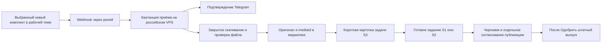

# S0: технические границы нового приёмника, только проектирование

После уточнения оператора от 7 ноября сначала обсуждается весь путь входящего материала до публикации. Реализация, интеграция, выкладка и опросы в группе не запускались. Формой и сценарием владеет S3, общий сценарий для обсуждения собирает Запускатор. S0 не меняет параллельно их модули.

## Фактически проверено

Проверка на VPS 7 ноября в21:32МСК: сервер1a8d1dc, собственный бот подтверждён через getMe. Действующий webhook указывает на ожидаемый клиентский релей и путь, query пуст; сообщения и callback_query разрешены, ожидающих обновлений0, ошибки webhook не заявлены. Секрет задан, значение не читалось и не выводилось.

Через getChatMember запрошено состояние только самого бота в заранее известной рабочей группе: administrator, управление темами разрешено. Флаг can_read_all_group_messages=false. Он не означает, что администратор не получает вложения: [официальный FAQ Telegram](https://core.telegram.org/bots/faq#what-messages-will-my-bot-get) отдельно разрешает ботам-администраторам получать сообщения людей в группе. Менять privacy mode или права для проверки не требуется. Это разрешающая настройка, а не доказательство получения конкретного фото Павла.

По исходникам onTelegram отдельного media-intake нет. Сервер возвращает Telegram HTTP200 до фоновой обработки. Релей умеет передавать методы Bot API и исходящую загрузку, но отдельного защищённого скачивания Telegram-файлов в текущем исходнике нет; проверенный путь /download/getFile с пустым телом вернул404. Реальные file_id не запрашивались. getUpdates, история сообщений, перечень участников, логи с текстами и скачивание конкретных вложений не использовались.

Безопасные результаты: `content/reports/telegram/2026-11-07/media-intake-readiness.json`. Не говорить «фото видны/сохранены», пока не будет отдельно разрешённого пилота и подтверждения файла в медиатеке.

## Предлагаемый технический путь, ещё не реализован

1. Приём ограничивается согласованной темой и выбранным новым комплектом, не всей старой перепиской. Сначала сохраняется минимальная квитанция на российском VPS с update_id/message_id, принадлежностью комплекту и техническими ссылками на вложения. Полное входящее событие, автора и цитаты не передавать модели. Права инициатора/редактора проверяются внутри сервера.
2. Квитанция и ключ дедупликации должны переживать перезапуск до HTTP200. Само скачивание и работа модели не выполняются внутри ожидания webhook. Сейчас гарантия сохранения до подтверждения отсутствует: её нужно спроектировать отдельно, а не считать достаточной текущую фоновую функцию.
3. Для файла релей получает только авторизованное серверное поручение с file_id. Он обращается к фиксированному Telegram API и передаёт байты потоком на VPS. Токен не покидает релей, URL с токеном и file_path не попадают в карточки, snapshot или журналы. Не принимать произвольный URL/путь, не следовать редиректам на посторонний хост; проверять заявленный размер и фактически принятые байты.
4. На VPS файл сначала закрытый временный. Проверяются размер, тип по содержимому, целостность и квота; неполный файл не становится mediaId. Штатный importMedia создаёт original с источником и материалом. Оригинал не выдаётся публично; для публикации создаётся отдельная версия с последующим согласованием.
5. Завершённая карточка цели/назначения/каналов создаёт задание, а не одобрение публикации. Передача S1/S2 должна иметь собственные claim/ack и защиту от повторов. Использовать существующий единственный сторож, не добавлять модельный опрос на каждое вложение или новый cron.

## Ограничения, которые нужно учесть в сценарии

- Облачный [getFile](https://core.telegram.org/bots/api#getfile) скачивает файлы до20MB. Размер, который человек может отправить в Telegram, и лимит исходящей отправки ботом не означают поддержку скачивания больших роликов. Нельзя обещать приём любого видео в текущей схеме.
- Для большого видео нужно отдельно выбрать закрытую прямую загрузку в российское хранилище либо отдельный локальный Bot API Server. [Локальный Bot API](https://core.telegram.org/bots/api#using-a-local-bot-api-server) снимает ограничение скачивания, но это новый компонент, а не настройка уже работающего webhook. Ничего из этого не развёрнуто.
- Полученное как photo — версия, предоставленная Telegram, часто сжата. Нельзя автоматически назвать её оригиналом камеры. Если нужна исходная фотография/видео, сценарий должен объяснять отправку как файла и сохранять происхождение. Имя и MIME следует сохранить из входящего сообщения: getFile не гарантирует их сохранение.
- Альбом приходит отдельными обновлениями. Нужно решить, как человек подтверждает полный комплект, что происходит с поздним кадром и как не получить пять карточек на один альбом. Один таймер тишины не доказывает полноту.
- Сейчас allowed_updates включает message и callback_query, не edited_message. Простое редактирование старой подписи в Telegram нельзя обещать как надёжный способ изменить задачу. Предпочтителен понятный путь через карточку; изменение подписок webhook обсуждается после утверждения сценария.
- Перенос цели/каналов и согласие на публикацию должны быть разными решениями. Для кадров с людьми, детьми, названием заказчика, цифрами и обещаниями вопросы решаются до подготовки публикации; источник и подтверждение сохраняются без вывода переписки.
- Отсутствие независимого backup и готовность крупного файлового хранилища — отдельные открытые пункты. Успех локального восстановления18 существующих записей не доказывает приём нового комплекта и не делает большие файлы поддержанными.

## Что согласовать вместе с S3 до реализации

Кто и в какой теме сдаёт комплект; как подтверждается его полнота; какие цель/назначение/каналы обязательны; какие ответы можно подставить по умолчанию; кто может исправить карточку; как обрабатываются неизвестные факты, права на фото и большие файлы; что видит человек при сбое; когда задача считается переданной S1/S2; где отдельно утверждается итоговый текст и медиа. Все вопросы сводятся в общий сценарий, сейчас в группу ничего не отправляется.

После утверждения сценария S3 готовит свой модуль и тесты, S0 согласует транспортный контракт и единую выкладку. Первый живой тест — только новый выбранный комплект, без массового опроса старых файлов. Результат приёма подтверждается числом файлов, mediaId и состоянием задачи; результат публикации — реальной ссылкой или точным статусом ручной передачи.
